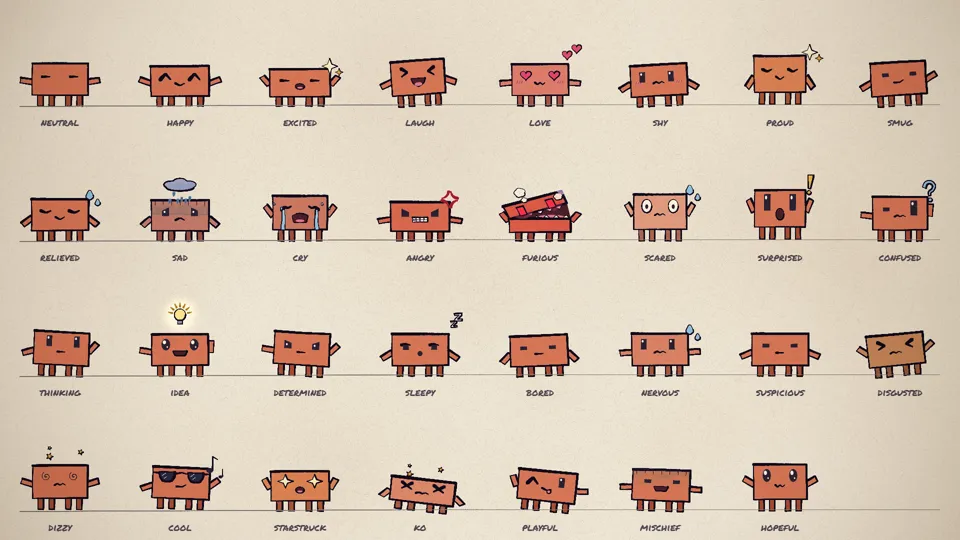

# Painted Animation Agent Kit

**English** | [中文](README.zh-CN.md)

A kit for coding agents (Claude Code and similar) to make hand-painted 2D character animation videos. It gives the agent a ready-made painting engine and a production guide. Following the guide, the agent writes a storyboard, writes the scene code, renders check images to find its own mistakes, and outputs an MP4.

The look is ink lines over flat colour. Lines wobble slightly like hand-drawn animation (they "boil"), colour areas stay still and never flicker, and characters carry no cast shadows or lighting. The default character is Clawd; swap in any character you like.



## How to use it

Open Claude Code in this folder and say what you want:

> Make a 15-second video of Clawd trying to catch a butterfly.

The agent first reads [ANIMATION_GUIDE.md](ANIMATION_GUIDE.md) ([CLAUDE.md](CLAUDE.md) tells it to), then follows its workflow: storyboard first, build shot by shot, review with rendered check images, and output `out/video.mp4`.

For long pieces (over a minute, or several sections), ask the agent to follow the guide's section on long films: split the piece into chapters and hand them to several sub-agents working in parallel. The agent will also suggest whether to make it chapter by chapter, where each chapter is rendered and revised on its own and the chapters are joined at the end.

The guide is written in Simplified Chinese. Agents read it fine either way.

## Run it yourself

You need Node.js, Google Chrome and ffmpeg.

```bash
npm install
node render.mjs --clip --out=out/video.mp4
```

This renders the 11-second example in [src/scenes/demo.js](src/scenes/demo.js). Open [studio.html](studio.html) in Chrome to scrub through it; add `?loop=emotions` or `?loop=views` to see the model sheets. If Chrome isn't in a standard location, pass `--chrome=<path>` or set `CHROME_PATH`.

Without a dedicated GPU, watercolour fills slow rendering down to a few seconds per frame. For headless Linux and machines with no GPU, see the notes at the top of [render.mjs](render.mjs) and `gpu_probe.mjs`.

Long renders look after themselves: `--frames` re-renders any frame that comes out black (a lost WebGL context), reopens pages every few hundred frames, and pauses workers while free memory is low (`--low-gb`, `--resume-gb`). If a render is stopped, run the same command again; finished frames are skipped. Chapter mode adds `--chapter` and `--concat`; see the notes at the top of [render.mjs](render.mjs).

## What's here

| Path | What it is |
|---|---|
| [ANIMATION_GUIDE.md](ANIMATION_GUIDE.md) | The production guide: rules, animation principles, workflow, long-film collaboration, full API. Agents read it all before starting |
| [CLAUDE.md](CLAUDE.md) | Entry instructions for the agent |
| [src/core.js](src/core.js) | Painting, timing, motion helpers, camera, light, paper |
| [src/clawd.js](src/clawd.js) | Clawd: views, emotions, eyes, mouths, hats, emotes, dances |
| [src/timeline.js](src/timeline.js) | Shot registration, loops, brush-wipe transition |
| [src/chapters.js](src/chapters.js) | Optional chapter mode: chapter cards, chapter label, chapter-end wipes |
| [src/config.js](src/config.js) | Length and tempo; the chapter table in chapter mode |
| [src/sheets.js](src/sheets.js) | Model sheets (emotions, views) |
| [src/scenes/](src/scenes/) | Your video's scenes go here (the demo is only an example) |
| [render.mjs](render.mjs) | Headless renderer: contact sheets, frame strips, crops, stills, MP4; long-render guard; per-chapter render and join |
| [docs/](docs/) | Model sheets: [emotions](docs/emotions.jpg) ([animated](docs/emotions.webp)), [views, motion and hats](docs/views.jpg) |

## Credits

This project is adapted from two open-source projects by John Heibel:

| Project | How it is used |
|---|---|
| [ClaudeAnimationBase](https://github.com/JohnHeibel/ClaudeAnimationBase) (MIT, based on commit `0ac8bf2`) | The engine, renderer, character and demo code are modified from it; the guide is a translated and rewritten version of its English guide |
| [PDoomVideo](https://github.com/JohnHeibel/PDoomVideo) (based on commit `fa546a3`) | Only its methods for long films are borrowed: chapters, parallel sub-agents, one shot per lyric line, a recurring set that escalates each time. These are written into the guide in this project's own words. **None of its code or documents are included** |

The original MIT license is in [LICENSE](LICENSE).

## What changed from the originals

| What | Original | This project | Why |
|---|---|---|---|
| Character lighting | Clawd had a watercolour cast shadow, a top-left highlight, a dark band across the chin and watercolour shading on the arms | All removed: characters are flat colour plus ink lines; the 3/4 side face is one flat darker colour | No decorative lighting; a cleaner picture |
| Flickering colour | Watercolour fills redrew their bleed and texture 12 times a second, so even still colour areas flickered | Fills use a fixed seed and draw the same every frame; only ink lines boil | Flickering colour distracts the viewer |
| Ground contact | Feet stopped about 0.2u above the ground point, hidden by the shadow | Legs reach the ground point exactly; the model sheets' floor line sits at the feet | Without a shadow the gap shows |
| Flickering glow | `glow()` changed its radius by up to 3% on every boil frame | Still by default; a `flicker` argument lets each light flicker when the scene calls for it (the idea bulb emote does) | Whether a light should flicker depends on the light and the shot |
| Outline-free shapes | The demo sky's glow shapes moved their vertices up to 10 px every boil frame, so their edges and texture flickered | Colour shapes that stay on screen without an ink outline get no vertex jitter; the demo and guide are updated (brief motion effects such as transitions keep theirs) | Same as above |
| Highlight colour | Characters had a dedicated highlight colour, `lt` | Removed | Highlights are no longer drawn; keeping the option would invite agents to add them back |
| Scene lighting | Backgrounds use watercolour for sky, hills and shading | Kept, but no longer flickers | Only characters are restricted; scenes need depth |
| Long films | The base guide covered short films only | The guide adds a section on chapters and parallel sub-agents, a longer storyboard template and more on music | Lessons from PDoomVideo |
| Language | English | The guide and the code comments added in this project are in Simplified Chinese; the README is available in English (default) and Simplified Chinese | — |

Rule 1 of [ANIMATION_GUIDE.md](ANIMATION_GUIDE.md) explains these choices as intent and reasons, with concrete failure cases, rather than as hard rules: the agent is expected to think, not to fill in a formula. If a video really needs shadows or lighting, say so in the request: the guide puts the request first.

